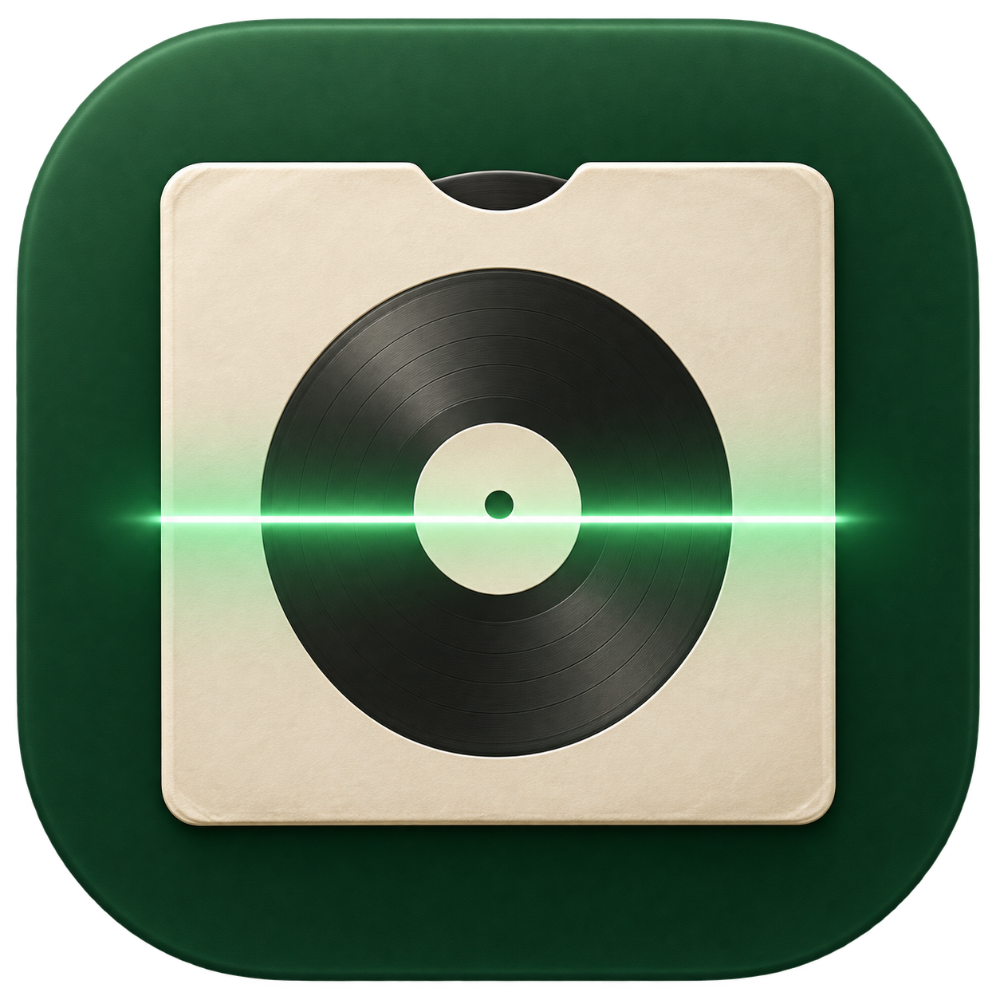

# Sleeve

Een macOS-app voor scans van je muziekcollectie: cd's en platen uitsnijden,
deelscans samenvoegen, later kleurvoorstellen maken en bestandsnamen overnemen
van een Discogs-uitgave. Met wachtrij, projecten en eindcontrole.



## Testversie 0.4.5

Nieuw in deze testversie: minder onnodig opnieuw opslaan bij het verwerken.
Verder beschikbaar: Discogs-releasevoorstellen en een aparte kleurstap
voor hoezen en platen. Ook beschikbaar: ronde uitsneden zelf bijstellen, één
onderdeel opnieuw verwerken en de geheugenfix voor grote FIRE-scans.
De eerdere publieke download staat bij Releases; deze versie wordt lokaal getest.

Apple Silicon, macOS 14 of nieuwer. De app is lokaal ondertekend en nog niet
bij Apple genotariseerd. Deze proefversie heeft een eenmalige installatie van
Python-beeldonderdelen nodig; die zijn nog niet in het appbestand gebundeld.
De interface is Nederlands. De werking is getest op één Mac; een schone,
andere Mac is nog niet getest.

## Installeren

Download het volledige app-pakket via [Releases](https://github.com/reprise-labs/sleeve/releases).

1. Pak het volledige downloadpakket uit en verplaats `Sleeve.app` naar je Apps-map.
2. Voer `Installeer beeldonderdelen.command` uit vanuit het uitgepakte pakket.
   Bewaar de meegeleverde `scripts`-map en `requirements.txt` ernaast.
   Dit maakt een aparte Python-omgeving onder
   `~/Library/Application Support/com.repriselabs.Sleeve/Runtime`.
3. Open Sleeve. Als de installatie geen geschikte Python vindt, installeer dan
   Python 3.11 via [python.org](https://www.python.org/downloads/macos/),
   of met Homebrew: `brew install python@3.11`. Voer de installatie daarna opnieuw uit.

Op de oorspronkelijke ontwikkel-Mac kan de bestaande Python-installatie ook
worden gebruikt. Voor andere Macs is de aparte omgeving de bedoelde route.
De installer heeft internet nodig om NumPy, Pillow en OpenCV te downloaden.

## Gebruik

- **Scans verwerken:** selecteer één uitgave uit één bronmap. Verwerk cd en vinyl
  apart. Gemengde cd/vinyl-invoer is niet getest. Markeer etiketclose-ups als
  referentie. Elke verwerking krijgt een nieuwe submap.
- **Discogs:** namen en stand zijn apart te kiezen. Controleer de juiste uitgave.
  Gebruik voor vinylkleur bewust een foto van de volledige plaat via Kleur aanpassen.
- **Kleur aanpassen:** ook later opnieuw mogelijk. De vinylmethode beschermt het
  etiket en transparantie. De kleur is een voorstel, geen exacte meting.
- **Namen aanpassen:** controleer het voorstel. Sleeve maakt zelfstandige kopieën.
- **Wachtrij:** stel een taak in, zet hem klaar en voeg desgewenst andere taken toe.
  De lijst verwerkt taken na elkaar met hun eigen instellingen. Een fout of
  onderbreking pauzeert de lijst. Er wordt na heropenen niets vanzelf herhaald.
- **Projecten:** bewaar als `.sleeveproject` en open later via het Project-menu.
  Eerdere `.anoukproject`-bestanden kunnen ook worden geopend. Referentiefoto's,
  instellingen, geschiedenis en beoordelingen worden bewaard. Bron- en
  resultaatbeelden blijven gekoppeld aan hun locatie: laat die mappen staan.
- **Eindcontrole:** leesbaarheid en ronde uitsneden worden gemeten. Beoordeel
  volledigheid, bestandsnamen en kleur zelf. Die drie punten worden nooit
  automatisch goedgekeurd. Gewijzigde bestanden verliezen hun eerdere goedkeuring.

De voortgang meet beschikbare werkermeldingen binnen een stap. Voor stappen
zonder meetbare voortgang verschijnt een lopende indicator, geen verzonnen totaal.

## Privacy en verbindingen

Beeldverwerking gebeurt lokaal, zonder AI-API. Voor Discogs worden openbare
gegevens en referentiefoto's opgehaald; scans worden niet geüpload. Een firewall
zoals Little Snitch kan voor een nieuwe appversie opnieuw toestemming vragen
voor `api.discogs.com` en `i.discogs.com`.

De meegeleverde voorbeeldplaten zijn synthetisch. Persoonlijke scans,
testprojecten en lokale instellingen maken geen deel uit van deze repository.

## Bouwen

Xcode Command Line Tools en een geschikte Apple Silicon Mac zijn nodig:

```sh
zsh build.sh
```

De OCR-helper wordt tijdens het bouwen gecompileerd, zodat de app daarvoor
geen bestanden in zijn eigen ondertekende pakket hoeft te wijzigen.

## Testen

```sh
zsh scripts/check.sh
```

De controles maken tijdelijke bestanden en testen beeldvorm, beschadigde
bestanden, etiket/transparantie, voortgang, stoppen, projecten en wachtrij.
Grote echte albumscans en de native vensters zijn lokaal aanvullend getest;
synthetische checks bewijzen niet dat elke mogelijke scan correct wordt verwerkt.

## Reprise Labs

Sleeve is een apart project naast [Reprise](https://github.com/reprise-labs/reprise).
De twee apps hebben eigen versies en downloads. Deze repository wijzigt Reprise niet.

## Nieuw: uitsnede bijstellen

Selecteer een geladen cd- of vinylbeeld en kies **Ronde uitsnede bijstellen…**.
Sleep de cirkel of gebruik de schuiven; de plus/min-knoppen verplaatsen het
middelpunt of de diameter per pixel. **Toon uitgeknipt voorbeeld** laat het
resultaat direct zien. Een cirkel buiten de bron kan niet worden bewaard.

Kies **Kies oorspronkelijke scan…** als een eerdere uitsnede al te veel heeft
verwijderd. De nieuwe uitsnede blijft een echte cirkel, zonder uitrekken van
het beeld. Alleen de buitenrand verandert: het middengat en eventuele gaten
blijven zoals in de bron. Pixels binnen de cirkel, DPI en ICC-profiel blijven
behouden. De buitenste rand krijgt een zachte overgang van één pixel.

**Bewaar nieuwe uitsnede** maakt een nieuwe PNG en vervangt alleen het gekozen
resultaat in het project. De bron en de vorige poging blijven op schijf staan.
De nieuwe versie vraagt opnieuw een eindcontrole.

## Nieuw: één onderdeel opnieuw verwerken

Selecteer een resultaat en kies **Dit onderdeel opnieuw verwerken…**, of kies
**Onderdeel opnieuw…** in de eindcontrole. Controleer de aangevinkte bronbeelden;
als niet bekend is welke scans bij het onderdeel horen, kies je ze zelf.
Gebruik één bronmap. De selectie wordt als één onderdeel verwerkt, bijvoorbeeld
alleen kant B. Er moet precies één nieuw resultaat ontstaan; anders blijft de
vorige versie actief. Bij een fout of annulering blijven de andere resultaten
én hun beoordelingen behouden.

De oorspronkelijke Discogs-instellingen worden uit de bewerkingsgeschiedenis
gebruikt als die beschikbaar is. Vinylkleur pas je daarna zo nodig apart toe.
De gebruikte bronkeuze wordt bewaard voor een volgende poging.

Bij een correctie of herhaling toont de bestaande voor/na-schuif **de vorige
poging tegenover de nieuwe poging**. Via **Eerdere bewerkingen** kun je een
oudere stand terugzien. Projecten bewaren deze geschiedenis en verwijzingen;
laat dus ook de mappen met vorige versies staan.


## Nieuw in 0.4.2: eerst verwerken, daarna kleur kiezen

Bij Scans verwerken gebruikt Discogs alleen nog bestandsnamen en draairichting.
Een opgeslagen oud vinkje voor hoeskleur schakelt geen kleurcorrectie meer in.
Voor een hoes kies je later Kleur aanpassen → Hoes / ander beeld · passende foto.
Voor vinyl blijft de aparte methode met behoud van het etiket beschikbaar.
Bekijk en vergelijk het voorstel voordat je het verder gebruikt.

## Nieuw in 0.4.2: mogelijke Discogs-uitgaven

Na het laden van scans zonder uitgavelink leest Sleeve lokaal tekst en barcodes
uit maximaal zes verkleinde beelden. Zodra een bruikbare barcode gevonden is,
stopt het verder lezen. Alleen zoektermen gaan naar Discogs, geen afbeeldingen.
Bekijk releasevoorstellen toont maximaal vijf mogelijke uitgaven, met formaat,
jaar, land, catalogusnummer en eventuele variant/kleur. Een gedeelde barcode
kan meerdere persingen opleveren. Pas Gebruik deze uitgave vult de link in.
De zoekgegevens zijn aanpasbaar; zoeken kan worden gestopt en hervat.
Een bestaande uitgavelink wordt niet automatisch vervangen. Je kunt ook zelf
op Discogs zoeken en een link plakken. De herkenning kan onvolledige of
verkeerd gelezen tekst opleveren en bevestigt de exacte persing niet.


## Onderdelen en verschillend bijgesneden deelscans

Scans met dezelfde dpi behouden bij het groeperen dezelfde fysieke schaal,
ook als één deel kleiner is bijgesneden. Onbekende voorlopige resultaten heten
Nog te bepalen. Een afgebroken naamgevingsstap maakt niet alle beelden Voorkant.
Bekende onderdelen en hun bronbeelden worden bij elk resultaat bijgehouden.
Voorkant en achterkant kunnen met de passende Discogs-hoesfoto en barcode
worden voorgesteld; controleer de namen altijd in de eindcontrole.


## Nieuw in 0.4.3: duidelijke voortgang

Een groot voortgangsvak toont het huidige onderdeel, het aantal verwerkte
onderdelen, de actuele stap, de totale tijd en de tijd van de huidige stap.
Ook voorbereiden, scans vergelijken, belichting tussen deelscans afstemmen en
het afwerken van overgangen geven voortgang door. Balken en percentages zijn
gebaseerd op getelde beelden, vergelijkingen of verwerkte beeldstroken.
Bij opslaan, tekstherkenning en Discogs vergelijken wordt geen percentage
geraden: je ziet een activiteitbalk en de naam en duur van die stap.
Een fasepercentage is geen percentage van de gehele opdracht of een tijdschatting.


## Nieuw in 0.4.4: duidelijke kleurstap en meerdere vinylkanten

1. Open Kleur aanpassen en voeg de afgewerkte beelden toe.
2. Kies Vinylplaten: vink kant A en B aan. Hoezen worden apart gehouden.
3. Haal Discogs-foto’s op en klik op de volledige plaat met de gewenste kleur.
4. Klik Maak nieuwe kleur voor 2 vinylkanten.

Beide nieuwe kleurkopieën worden meteen opgeslagen en samen getoond.
Er is geen aparte knop Overnemen nodig. De knoppen Origineel, Vergelijken en
Nieuwe kleur maken duidelijk wat je bekijkt. De nieuwe kleur is standaard
volledig zichtbaar; de vergelijkingsschuif loopt van origineel naar nieuwe kleur.
De eindcontrole opent pas als je die zelf kiest. Via Toon dit kleurbestand in
Finder vind je precies het geselecteerde bestand.

Een eerdere kleurkopie van A blijft in beeld als je later alleen B opnieuw
verwerkt. Bij de stap Namen aanpassen blijven de hoezen en beide kleurkopieën
samen beschikbaar. Je aangevinkte beelden worden in projecten bewaard.
Voor een hoes kies je Hoes en één passende hoesreferentie. Bij wisselen tussen
hoes en vinyl moet je opnieuw een passende referentiefoto kiezen.
